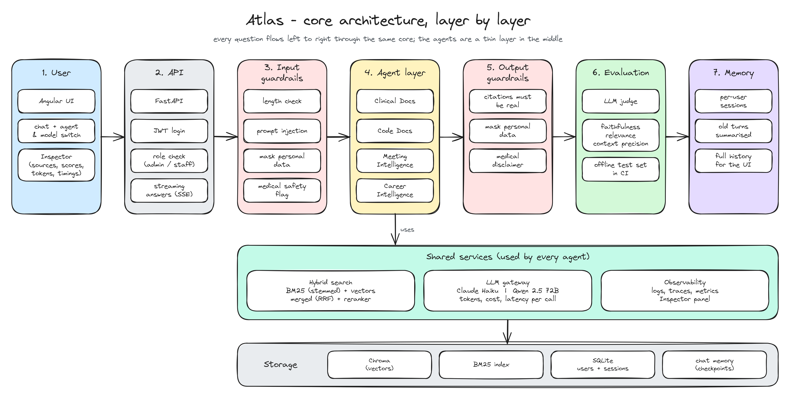
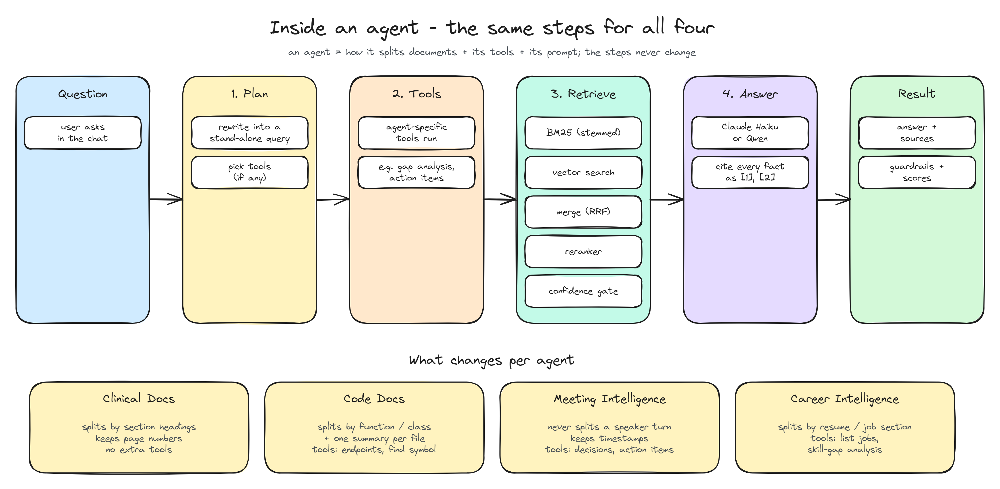

# Atlas

Atlas is my submission for the Newpage Forward Deployed Engineer assignment. It's a full-stack
conversational AI app, and instead of picking one of the four options I built all four as agents
in the same application:

- **Clinical Docs** (option 1) answers questions about healthcare documents. I loaded it with
  real FDA drug labels, MedlinePlus health topics and a ClinicalTrials.gov record.
- **Code Docs** (option 2) answers questions about a codebase. It indexes this repo on startup, and
  you can point it at any public GitHub repo.
- **Meeting Intelligence** (option 3) works on meeting transcripts with speakers and timestamps and
  can pull out decisions and action items.
- **Career Intelligence** (option 4) compares a resume against several job descriptions and finds
  skill gaps.

The backend is Python (FastAPI + LangGraph), the frontend is Angular, and it runs as a single Docker
container on Hugging Face Spaces. You can switch between Claude Haiku and an open-weight model
(Qwen 2.5 72B through Hugging Face) from the UI.

Live demo: `https://huggingface.co/spaces/<your-user>/atlas` (link to be added after deploy)


## Why I put all four options in one app

When I read through the four options, they looked like the same problem to me. In every case you
have some documents, you need to find the right pieces of them, and you need to answer with
references. What changes is the kind of document (a drug label, source code, a transcript, a
resume) and a few steps that only make sense for that domain.

So I thought all four could be built on the same core architecture, and that was my motive for
doing it this way. I wanted to spend my time getting the core right (retrieval, guardrails,
evaluation, memory, access control) and then put each option on top as a small agent. A nice side
effect is that adding a fifth use case later is mostly configuration, not a new application.

## Running it locally

Copy the env file and add your keys if you have them. Both keys are optional:

```bash
cp .env.example .env
```

Then start the backend and frontend in two terminals:

```bash
cd backend
uv sync
uv run python -m uvicorn app.main:app --reload --port 8000
```

```bash
cd frontend
npm install
npx ng serve
```

Open http://localhost:4200. The first backend start takes about a minute because it indexes all
the sample data.

If you prefer Docker: `docker compose up --build` and open http://localhost:7860.

Logins:
- `admin / admin123` can use all four agents and see the eval dashboard
- `staff / staff123` can only use Clinical Docs and Code Docs

If no API key is set, the app still works in an offline demo mode. Search, guardrails and the
Inspector are all real, but the "answer" is just a quote from the best matching passage.

Tests: `cd backend && uv run pytest` (63 tests) and `cd frontend && npx ng test --watch=false` (8 tests).

To deploy to Hugging Face, create a Docker Space, add the secrets `ANTHROPIC_API_KEY`, `HF_TOKEN`,
`JWT_SECRET`, `ADMIN_PASSWORD` and `STAFF_PASSWORD`, and run:

```bash
HF_TOKEN=<write-token> HF_SPACE=<user>/atlas uv run --with huggingface_hub python backend/scripts/deploy_hf.py
```

## The core architecture and how the agents sit on top

The idea is simple: there is one core that every question goes through, and the agents are a thin
layer on top of it.



### What's common to every agent

These parts are written once and every agent gets them for free:

- **Input guardrails.** Before anything else, the question is checked for prompt injection, personal
  data (emails, phone numbers, IDs) is masked, and personal medical questions like "how much should
  I take" get flagged so the answer comes with a disclaimer.
- **Access control.** The user's role is checked before an agent runs. I check it in the API, inside
  the graph itself, on uploads and in the MCP server, so hiding things in the UI isn't the only line
  of defence.
- **Hybrid search.** Keyword search (BM25 with stemming) and vector search run side by side, the
  results are merged, and a reranker puts the best passages on top. If nothing relevant is found the
  agent says so rather than making something up.
- **LLM gateway.** One interface for both Claude and the open-weight model. Every call records
  tokens, cost and time.
- **Output guardrails.** Answers have to cite real sources, personal data is removed again, and the
  medical disclaimer is added when needed.
- **Evaluation.** A small judge model scores every answer for faithfulness, relevance and how useful
  the retrieved passages were. There is also an offline test set that runs in CI.
- **Memory.** Each user's chats are saved, and older messages get summarised so prompts stay small.
- **Observability.** Structured logs, traces and metrics, plus an Inspector panel in the UI where you
  can see the sources, guardrail results, scores, token usage and timings for every answer.

### What each agent adds

An agent is basically a configuration plus a prompt. It defines how its documents are split up and
which extra tools it has:

- **Clinical Docs** splits documents by section headings like "Contraindications" and keeps page
  numbers. No extra tools needed.
- **Code Docs** splits code by function and class and adds a short summary per file. Its tools can
  list API endpoints, find where something is defined and read dependency files.
- **Meeting Intelligence** never splits a speaker's turn and keeps the timestamps. Its tools extract
  decisions and action items.
- **Career Intelligence** splits resumes and job descriptions by section (skills, experience,
  requirements). Its tools list the jobs and run a skill-gap analysis.



Every agent follows the same steps: plan the search, run any tools, retrieve passages, and answer
with citations. To add a new agent you add one config entry, one prompt file and a few test
questions. There's more detail in [docs/architecture.md](docs/architecture.md).

The diagrams are Excalidraw files in [docs/diagrams/](docs/diagrams). Open any `.excalidraw` file at excalidraw.com (or with the VS Code Excalidraw extension) to edit it.

## RAG and LLM choices

- **Chunking** is different for each agent (see above), because each document type has its own
  natural boundaries and it keeps citations meaningful.
- **Embeddings:** `bge-small-en-v1.5`, running locally on CPU. It's free and quick, and the documents
  never leave the app.
- **Search:** BM25 with stemming plus vector search, merged with Reciprocal Rank Fusion and reranked
  with a cross-encoder. Keywords are good at exact terms like doses or "eGFR", and vectors are good
  at paraphrases.
- **Vector DB:** ChromaDB, embedded, because the demo runs in one container. In production I'd use
  pgvector.
- **LLMs:** Claude Haiku 5.5 or Qwen 2.5 72B, chosen per message, so you can compare a closed and an
  open model on the same pipeline.
- **Orchestration:** LangGraph, because the steps are explicit, memory per chat is built in, and it
  can stream progress to the UI.
- **Prompts** are kept as files in the repo with strict rules: cite every fact, and say "I couldn't
  find this" when the sources don't have the answer.

I tested retrieval instead of assuming it works. On 42 test questions every search mode except plain
keyword search got the right passage into the top 6, and the reranker helped most for code and
meetings. I went with a smaller reranker (about 0.6 s per query) over a bigger one (about 4.6 s)
because the demo runs on CPU. The full numbers are in [ADR-0002](docs/adr/0002-hybrid-retrieval-and-reranker.md)
and on the admin eval dashboard.

## Taking it to production on AWS Bedrock

For a healthcare client I would move the models to AWS Bedrock, so the LLM runs in a closed
environment:

- Bedrock doesn't use our prompts or responses to train models, and doesn't share them with the
  model providers.
- Calls go through a VPC endpoint (PrivateLink), so traffic stays inside our AWS network and region,
  and data is encrypted with our own KMS keys.
- Bedrock is HIPAA-eligible under a BAA, and every call is logged in CloudTrail for audits.

### How I'd implement it

Since the app already talks to models through one interface, the change is small:

1. Add a `BedrockProvider` next to the current Claude provider, using the Anthropic SDK's Bedrock
   client (model IDs look like `anthropic.claude-haiku-5-5`). The agents and the graph don't change.
2. Run the API on ECS Fargate (or EKS) in private subnets behind a load balancer and WAF.
3. Replace the embedded storage with Aurora Postgres + pgvector for vectors, keyword search, users,
   sessions and chat memory.
4. Move document ingestion into a background pipeline: S3, then SQS, then worker containers.
5. Use Cognito or the company's SSO for login, Secrets Manager for keys, and CloudWatch /
   OpenTelemetry for logs, traces and cost dashboards. Bedrock Guardrails can be added on top of the
   app's own guardrails.


### Scaling, and using bigger models

- I'd keep Haiku for the cheap steps (planning, judging, summaries) and use a bigger model such as
  Claude Sonnet or Opus on Bedrock only for the final answer, when the question is hard or the
  quality really matters. The app already separates a "fast" and a "main" model, so this is a
  config change.
- For steady load on the bigger models I'd use Provisioned Throughput, and cross-region inference to
  handle spikes.
- The API doesn't keep state, so ECS can just add containers under load. Embeddings and the reranker
  can move to their own model service, on GPU if needed.
- To keep costs down: prompt caching, caching answers to repeated questions, judging a sample of
  answers instead of every one, and budgets with alarms per team.
- Before switching to a bigger model I'd run the same eval suite on both and compare quality,
  latency and cost. The harness for that is already in the repo.

The longer version, including GCP, Azure and Cloudflare equivalents, is in
[docs/productionization.md](docs/productionization.md).

## Key decisions

1. One core with agents as configuration, so the hard parts are built once ([ADR-0001](docs/adr/0001-shared-core-agent-specs.md)).
2. Hybrid search with a reranker, picked by measuring it ([ADR-0002](docs/adr/0002-hybrid-retrieval-and-reranker.md)).
3. Chunking per document type ([ADR-0003](docs/adr/0003-domain-chunking.md)).
4. One LLM interface so Claude and open-weight models are interchangeable ([ADR-0004](docs/adr/0004-llm-port-and-planner.md)).
5. One container for the demo, with clear places to swap in production services ([ADR-0005](docs/adr/0005-single-container-embedded-stores.md)).

## Engineering standards

What I followed: the core doesn't depend on the agents, all config comes from environment variables,
roles are checked in several layers, 71 automated tests, linting and type checking (ruff, mypy,
Prettier), a security scan (bandit), CI on GitHub Actions, a Docker image, and short ADRs for the
main decisions.

What I skipped for time: browser end-to-end tests in CI, a DAST scan, a user management screen, a
proper mobile layout, and rate limiting that works across several instances.

## How I used AI tools

I used Claude Code in a plan, build, verify loop. I reviewed the plan and changed it before any code
was written (hybrid search with stemming and a reranker, healthcare sample data, Hugging Face for the
open model, Haiku only for Claude). The project rules for the assistant are in [`CLAUDE.md`](CLAUDE.md),
and there are reusable reviewer and test-writer sub-agents and commands in `.claude/`. Every step was
checked with tests, linting and the eval harness, and I looked at screenshots of the UI, which
caught a real bug in query rewriting that the unit tests had missed.


## What I'd do with more time

- Run the full eval comparing Claude and the open-weight model and publish the results.
- Build bigger test sets from real questions.
- Add voice-to-transcript for meetings (Whisper).
- Smarter code chunking with tree-sitter, and multi-step tool use.
- Build out the production setup described above.

## Known limitations

- Scanned PDFs aren't OCR'd, and tables inside PDFs lose their structure.
- Personal data masking is pattern-based, so it won't catch names.
- The confidence thresholds were tuned on small test sets.
- On a free Hugging Face Space, uploads and chats are lost on restart unless persistent storage is turned on.
- The medical content is reference information only, not medical advice.

<details>
<summary>More screenshots</summary>

| | |
|---|---|
|  Medical-safety guardrail |  Prompt injection blocked |
|  Token usage and cost |  Time per step |
|  Career agent |  Code agent |
|  Staff only sees 2 agents |  Admin eval dashboard |

These were taken in offline demo mode. With API keys set, the answers come from the selected model.
</details>

Where the sample data comes from, and its licences: [samples/SOURCES.md](samples/SOURCES.md).
