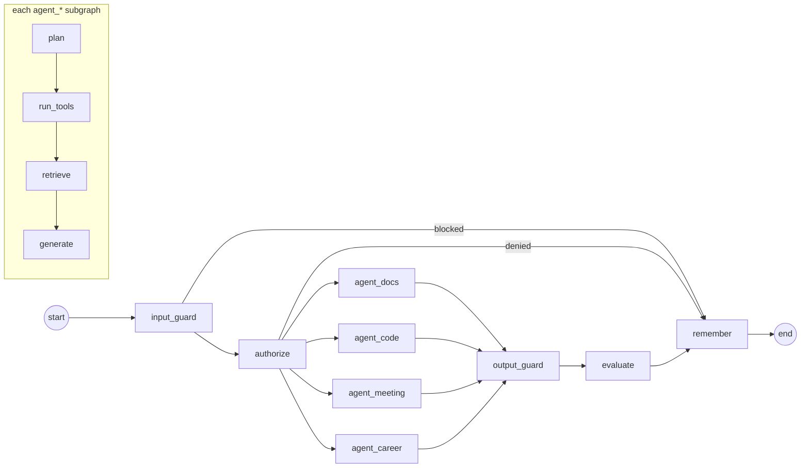

# Architecture in depth

## Layers and dependency direction
```mermaid
flowchart TB
  api["api/ — HTTP: auth, chat (SSE), knowledge, evals"] --> graph["graph/ — supervisor, state, stream events"]
  graph --> agents["agents/ — specs (domain packs), subgraph builder, tools, prompts, context"]
  agents --> core
  graph --> core
  api --> core
  subgraph core["core/ — domain-agnostic"]
    sec[security: auth, policy]
    llm[llm: port + adapters + pricing]
    ret[retrieval: analyzer, bm25, fusion, vectors, rerank]
    ing[ingestion: loaders, chunkers, pipeline]
    grd[guardrails]
    ev[evals: online judge]
    obs[observability]
  end
```
`core/` never imports from `agents/`, `graph/` or `api/`. `container.py` is the composition root
that wires concrete adapters (real or test doubles) into the graph.

## Supervisor graph


| Node | Responsibility | LLM calls |
|---|---|---|
| `input_guard` | length, injection (regex + classifier for ambiguous band), PII redaction, medical safety | 0–1 (fast) |
| `authorize` | RBAC via `policy.can_use_agent` | 0 |
| `plan` | standalone query rewrite + tool choice (structured output); skipped for tool-less agents without history | 0–1 (fast) |
| `run_tools` | allow-listed tools; always-run listing tools for meeting/career | 0–n (fast, cached per document) |
| `retrieve` | hybrid search, context budget, confidence gate | 0 |
| `generate` | streamed answer with numbered context; PII-redacting stream | 1 (main) |
| `output_guard` | PII on final answer, citation validity/coverage, medical disclaimer | 0 |
| `evaluate` | RAG-triad judge + deterministic metrics, groundedness flag | 0–1 (fast) |
| `remember` | append turn, compact history into summary, usage totals, metrics | 0–1 (fast) |

## State (`graph/state.py`)
- **Persisted per thread** (`user_id:session_id`, LangGraph `AsyncSqliteSaver`): `messages`
  (LLM working memory, compacted), `summary`, `transcript` (every turn with its sources,
  guardrails, evals and usage — what the UI reloads).
- **Per-turn scratch** reset by `new_turn(...)`: query, plan, tools, contexts, answer, guardrails,
  LLM calls, timings, evals, flags. Nodes return new lists instead of mutating state.

## Streaming protocol (SSE, `POST /api/chat/stream`)
| event | payload |
|---|---|
| `session` | session id/title (created on first message) |
| `status` | `{node}` — drives the live pipeline tracker |
| `guardrail` | `{item: {name, stage, action, detail}}` |
| `plan` | `{search_query, tools}` |
| `tool` | `{name, argument, output}` |
| `sources` | ranked passages with `bm25_rank`, `dense_rank`, `rrf_score`, `rerank_score` |
| `token` | `{text}` (already PII-redacted) |
| `eval` | `{metrics}` |
| `usage` | `{calls[], totals, timings}` |
| `done` | `{answer}` — authoritative final text |
| `error` | `{message}` |

## Storage
| Store | Contents | Production replacement |
|---|---|---|
| `atlas.db` (SQLite) | users (bcrypt), sessions | Postgres |
| `checkpoints.db` | LangGraph checkpoints per thread | Postgres/Redis checkpointer |
| `chroma/` | vectors + chunk text + metadata (`owner`, `source`, `section`, `page`, `symbol`, `ts_*`…) | pgvector |
| `bm25/<agent>.json` | analyzed tokens per chunk | Postgres full-text / OpenSearch |
| `documents/<agent>.json` | full text of each document (for whole-document tools) | object storage + Postgres |

## Security model
- JWT (HS256, 8 h) → `Principal(user_id, username, role)`.
- `policy.py` is the only RBAC matrix; enforced in API deps, the graph, ingestion and MCP.
- Ownership: `system` corpora are shared read-only; uploads are owned by the uploader; deletes
  require ownership (admins may delete shared sources).
- Untrusted content: retrieved text only ever appears inside the numbered CONTEXT block of the
  user message, behind an explicit "data, not instructions" rule.
