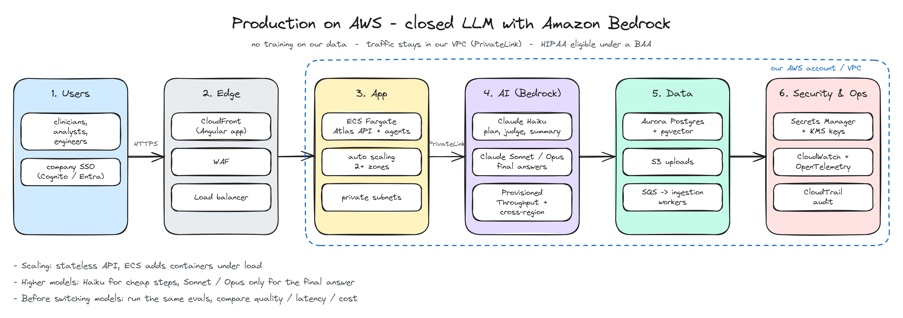
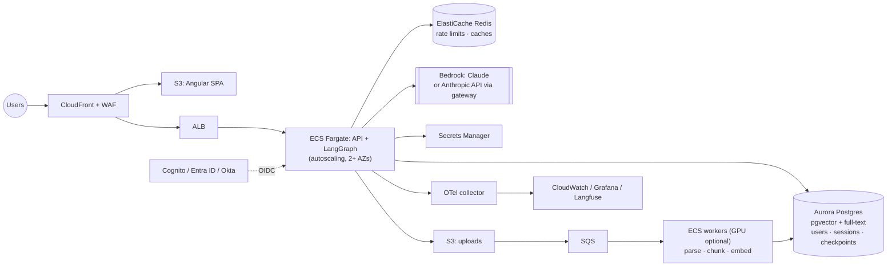

# Productionizing Atlas

The demo optimises for "one container, zero external services". Production optimises for tenancy,
durability, scale and compliance. The code already has the seams (ports in `core/`, a composition
root, env-only config), so most of this is infrastructure, not rewrites.

## Reference architecture (AWS)

| Building block | AWS | GCP | Azure | Cloudflare |
|---|---|---|---|---|
| API runtime | ECS Fargate / EKS | Cloud Run / GKE | Container Apps / AKS | Workers (thin API) + Containers |
| Vectors + lexical | Aurora pgvector / OpenSearch | AlloyDB pgvector / Vertex Vector Search | PostgreSQL Flexible + pgvector / AI Search | Vectorize + D1 |
| Queue + workers | SQS + ECS | Pub/Sub + Cloud Run jobs | Service Bus + Container Apps jobs | Queues + Workers |
| Object storage | S3 | GCS | Blob Storage | R2 |
| LLM (Claude) | Bedrock | Vertex AI | Foundry | AI Gateway → Anthropic API |
| Open-weight | Bedrock / SageMaker / vLLM on EKS GPU | Vertex Model Garden / vLLM on GKE | Foundry / AKS GPU | Workers AI |
| Secrets | Secrets Manager | Secret Manager | Key Vault | Secrets Store |
| Identity | Cognito / IAM Identity Center | Identity Platform | Entra ID | Access |

## What changes, concretely
1. **Storage adapters:** `VectorStore` + `BM25Index` → one pgvector + `tsvector` implementation
   (hybrid in SQL, RRF in the app). `Database` → SQLAlchemy/Postgres. LangGraph checkpointer →
   Postgres saver. Row-level security on `tenant_id`/`owner`.
2. **Async ingestion:** uploads go to object storage; a queue message triggers workers that parse,
   chunk, embed (batch, optionally GPU) and index; the UI polls ingest status. Idempotent by
   content hash; dead-letter queue; re-index jobs on embedding-model change.
3. **Horizontal scale:** the API is stateless once stores are external; scale on RPS and p95.
   Rerankers/embedders become a separate model-serving service (TEI / Triton / SageMaker) so API
   pods stay small. Redis for rate limits and response/semantic caches.
4. **Identity:** OIDC login; roles from IdP groups mapped in `policy.py`; short-lived access tokens
   + refresh; audit log of every tool call and document access.
5. **LLM gateway:** central place for provider keys, quotas per tenant, retries/fallbacks
   (Claude ⇄ open-weight), prompt/response logging with PII scrubbing, cost attribution.
6. **Secrets:** managed secret store with rotation (JWT signing keys via JWKS + rotation, API keys
   per environment); nothing in images or env files.
7. **Observability & SLOs:** OTel traces across API → graph nodes → LLM calls; dashboards for
   latency per node, token spend per tenant, guardrail trip rates, judge scores; alerts on p95,
   error rate, faithfulness drop.
8. **Quality in the loop:** CI eval gates (already here) + nightly full eval, shadow evaluation of
   new prompts/models on sampled production traffic, user feedback (thumbs) feeding the golden set.
9. **Security:** WAF, SAST/DAST/SCA in CI, SBOM + signed images, private subnets + VPC endpoints for
   LLM APIs, egress allow-list, encryption at rest (KMS) and in transit.
10. **Compliance (healthcare):** HIPAA-eligible services under a BAA, PHI minimisation (redact
    before indexing where possible), data residency via regional Bedrock/Vertex endpoints,
    retention and right-to-delete across vectors, checkpoints and logs.

## Cost levers
Fast-tier model for planner/judge/summaries (already), prompt caching once prompts are long
enough, response caching for repeated questions, judge sampling (e.g. 10–20 % of traffic) instead
of every answer, batch embeddings, and CPU-friendly rerankers unless evals justify a bigger one.
